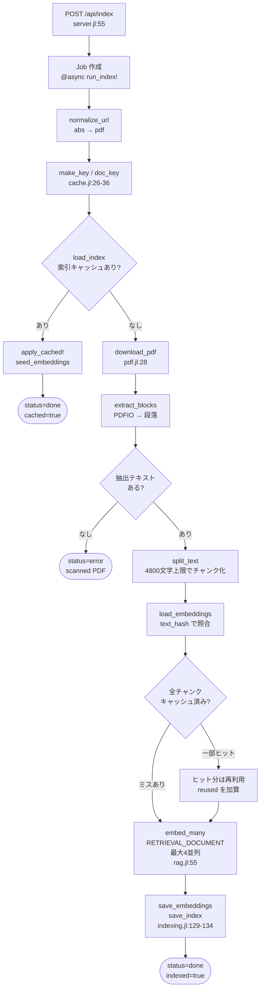
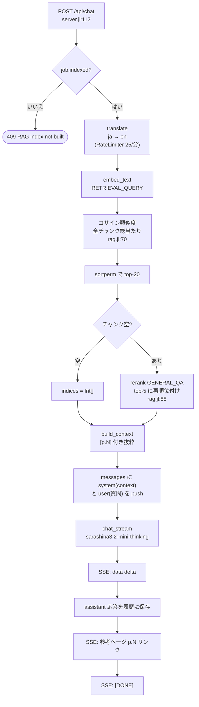
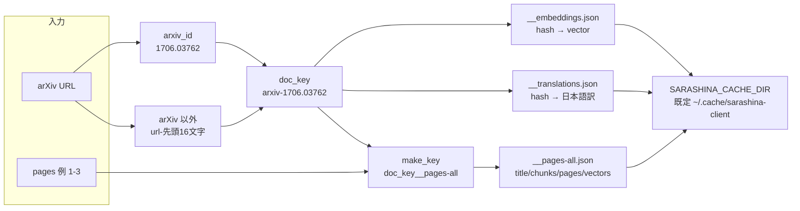

# SarashinaArxivViewer.jl

[Sarashina.jl](../Sarashina.jl) と [PDFIO.jl](https://github.com/sambitdash/PDFIO.jl) で作った arXiv RAG 解説ボット
([sarashina-arxiv-rag](https://github.com/terasakisatoshi/sarashina-arxiv-rag) の `sarashina-web` の Julia 版)。

```sh
# API キーは環境変数 SARASHINA_API_KEY、またはカレントの .env
julia --project=. -e 'using SarashinaArxivViewer; serve()'   # http://127.0.0.1:8000
julia --project=. test/runtests.jl                            # オフラインテスト(モック API)
```

流れ: arXiv URL → PDF 取得 → PDFIO で段落抽出 → `sarashina3-embedding` で索引 →
質問を英訳 → `RETRIEVAL_QUERY` 埋め込み + コサイン top-20 → `sarashina3-rerank` top-5 →
`sarashina3.2-mini-thinking` が日本語で SSE 回答(参考ページ付き)。左ペインの段落クリックで
`sarashina3.2-translate` による日本語訳。API は元実装と同じ(`/api/index`, `/api/paper`,
`/api/translate`, `/api/chat`, `/api/suggest`)。キャッシュは `~/.cache/sarashina-client`
(`SARASHINA_CACHE_DIR` で変更可、JSON 形式)。

元実装との差: 回答モデルを提供終了予定の `sarashina3-mini` から `sarashina3.2-mini-thinking` に変更。
RPM 制限はスライディング窓で管理(embedding 55/分, translate・chat 25/分 など)。
Sarashina.jl は `Project.toml` の `[sources]` で GitHub の URL から取得します(`Pkg.instantiate()`)。

## フローチャート

Mermaid なので GitHub / VS Code のプレビューでそのまま描画されます。

### 索引構築(`run_index!`)



### 質問応答(`api_chat` + `retrieve`)



### キャッシュのキーと読み書き



補足:

- 索引構築は `@async` で走るので、UI は `/api/index/{id}` をポーリングして `phase`(`extracting` → `embedding` → `done`)を表示する。
- 左ペインの段落クリックは上のチャットフローとは別に `/api/translate` を通る(`translate_chunk!`、既訳ならキャッシュから返り API を呼ばない)。
